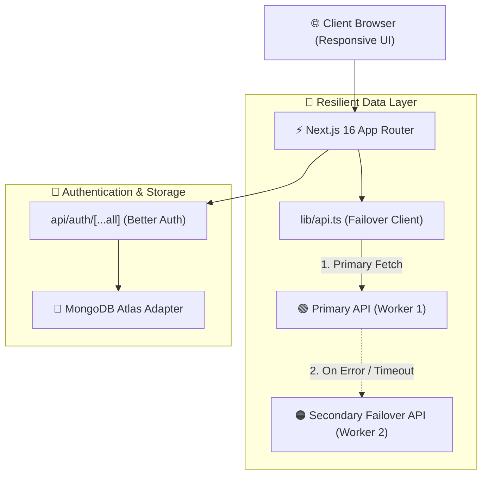

<p align="center">
  <picture>
    
  </picture>
</p>

<p align="center">
  <a href="https://readme-typing-svg.demolab.com">
    
  </a>
</p>

<p align="center">
  <!-- Framework & Runtime -->
  
  
  
  
  <br/>
  <!-- Auth, DB, Status -->
  
  
  
  
</p>

---

## 📌 Table of Contents
- [📖 Project Overview](#-project-overview)
- [🌟 5 Key Features](#-5-key-features)
- [🛠️ Technologies Used](#️-technologies-used)
- [🏗️ System Architecture & Data Flow](#️-system-architecture--data-flow)
- [🔐 Environment Configuration (.env.example)](#-environment-configuration-envexample)
- [🚀 Getting Started & Local Setup](#-getting-started--local-setup)
- [📁 Project Directory Structure](#-project-directory-structure)
- [📄 License](#-license)

---

## 📖 Project Overview

> **বাজার দর (BazarDor)** is a modern, high-performance, and resilient daily commodity price monitoring platform. It is engineered to provide citizens with accurate, real-time prices for essential groceries and commodities across various local markets.

The application adheres to a strict **zero-hardcoding principle**—all commodity rates, category definitions, and market statistics are fetched dynamically from live Cloudflare Workers microservices. If the primary API encounters network failures or rate limits, the system seamlessly and instantaneously fails over to an alternative secondary backup API with zero user disruption. The user interface features native Bengali localization, localized typography, and standard Bengali numerical formatting.

---

## 🌟 5 Key Features

### 1. 🔄 Resilient Dual-API Automatic Failover Architecture
- **Zero-Downtime Data Pipeline:** The client communicates through a unified API client wrapper. If the primary service (`BASE_URL_1`) fails or returns a non-200 status code, the request automatically falls back to the secondary mirror (`BASE_URL_2`).
- **Zero Hardcoding:** No prices, product listings, or categories are hardcoded. Every single data point is served live from the cloud APIs.

### 2. 📈 Infinite Live Price Ticker Marquee
- Positioned immediately beneath the navigation header, an infinite animated marquee ticker continuously streams current market rates.
- Displays the commodity emoji, name, live rate per unit, and percentage change indicator badges (`▲ Increase`, `▼ Decrease`, or `— Unchanged`).

### 3. 🗂️ Smart Category Filtering with Numeric Sorting
- Seamless categorization covering staple commodities: Rice, Lentils, Oil, Vegetables, Fish, Meat, Eggs & Milk, and Spices.
- **Accurate Mathematical Sorting:** Features sort modes (`Default`, `Price: Low to High`, and `Price: High to Low`) that parse Bengali numerical strings into numerical floats to guarantee accurate ascending and descending sorting orders.

### 4. 🛡️ Protected Product Analytics & Market Price Comparison Table
- **Guarded Route (`/product/[slug]`):** Requires active user session. Unauthenticated visitors are notified via interactive toast alerts and redirected to the login page with return-path retention.
- **Multi-Market Comparison:** Shows today's price, yesterday's price, minimum, maximum, and average benchmark rates alongside a comparative breakdown of key metropolitan markets (Karwan Bazar, Mirpur Green Market, Mohammadpur Krishi Market, etc.).

### 5. 🔐 Next-Gen Authentication with Live Profile Management
- **Better Auth Integration:** Offers robust email/password credentials and instant OAuth sign-in with Google and GitHub, backed by MongoDB Atlas.
- **Dynamic Profile Updates:** Users can inspect their account credentials on `/profile` and update their display name in real time on `/profile/edit` through the native Better Auth `updateUser` API.

---

## 🛠️ Technologies Used

| Category | Technology | Badge & Logo | Purpose |
| :--- | :--- | :--- | :--- |
| **Frontend Framework** | **Next.js 16** (App Router) |  | Server-side rendering, routing, and Turbopack bundler |
| **UI Library** | **React 19** |  | Declarative UI state management and component hooks |
| **Language** | **TypeScript** |  | Strict compile-time safety and interface contracts |
| **Styling** | **Tailwind CSS v4** |  | Custom design system tokens and responsive layouts |
| **Authentication** | **Better Auth** |  | Modern session engine, credential auth & OAuth providers |
| **Database** | **MongoDB Atlas** |  | Cloud database for user accounts, sessions & verifications |
| **Icons** | **Lucide React** |  | Crisp, lightweight icons |
| **Notifications** | **React Hot Toast** |  | Interactive toast alerts for auth states and protected routes |

---

## 🏗️ System Architecture & Data Flow



---

## 🔐 Environment Configuration (.env.example)

Create a `.env` file in the root directory of your project based on the template below:

```env
# ==========================================
# 🛒 বাজার দর (BazarDor) - Environment Config
# ==========================================

# 🔐 Better Auth Configuration
# Generate a secure 32+ character key: `openssl rand -base64 32`
BETTER_AUTH_SECRET=your_super_secret_32_character_key_here
BETTER_AUTH_URL=http://localhost:3000

# 🍃 MongoDB Connection URL
# Replace with your MongoDB Atlas connection string
MONGO_DB_URL=mongodb+srv://<username>:<password>@cluster0.mongodb.net/bazardor?retryWrites=true&w=majority

# 🌐 Commodity API Endpoints (Resilient Dual-API Architecture)
# Primary API endpoint
NEXT_PUBLIC_API_BASE_URL_1=https://api.api-store.workers.dev/api/bazardor
# Secondary failover API endpoint
NEXT_PUBLIC_API_BASE_URL_2=https://api.abcz.workers.dev/api/bazardor

# 🔑 OAuth Social Providers (Google & GitHub)
GOOGLE_CLIENT_ID=your_google_client_id.apps.googleusercontent.com
GOOGLE_CLIENT_SECRET=your_google_client_secret
GITHUB_CLIENT_ID=your_github_client_id
GITHUB_CLIENT_SECRET=your_github_client_secret
```

> [!TIP]
> A ready-to-use template file [`.env.example`](file:///.env.example) is already included in the repository root. You can create your environment file by running `cp .env.example .env`.

---

## 🚀 Getting Started & Local Setup

### Step 1: Clone the Repository
```bash
git clone https://github.com/mdsiam2007/bazardor.git
cd bazardor
```

### Step 2: Install Dependencies
```bash
npm install
```

### Step 3: Setup Environment Variables
```bash
cp .env.example .env
# Open .env and fill in your MongoDB and Better Auth secrets
```

### Step 4: Run the Development Server
```bash
npm run dev
```

Open [http://localhost:3000](http://localhost:3000) in your browser to explore the application.

---

## 📁 Project Directory Structure

```plaintext
bazardor/
├── .env.example                    # Sample environment variables configuration
├── package.json                    # Project dependencies and npm scripts
├── src/
│   ├── app/
│   │   ├── api/auth/[...all]/      # Better Auth route handlers
│   │   ├── category/[slug]/        # Category browse page & numeric sorting
│   │   ├── product/[slug]/         # Protected product details & market price table
│   │   ├── profile/                # User profile overview
│   │   │   └── edit/               # Live profile update page (updateUser API)
│   │   ├── signin/                 # Sign-in page with social providers
│   │   ├── signup/                 # Registration page
│   │   ├── not-found.tsx           # Custom 404 error page with Home link
│   │   ├── globals.css             # Theme design tokens & Hind Siliguri typography
│   │   ├── layout.tsx              # Root application layout & Toaster provider
│   │   └── page.tsx                # Home page (Top Risers, Fallers & All Products)
│   ├── components/
│   │   ├── Navbar.tsx              # Navigation bar with Bangla date & auth status
│   │   ├── PriceTicker.tsx         # Infinite scrolling live marquee ticker
│   │   ├── HeroBanner.tsx          # Hero banner with smooth scroll CTA
│   │   ├── ProductCard.tsx         # Product card with price trend badge
│   │   ├── ProductCardSkeleton.tsx # Loading skeleton placeholders
│   │   └── Footer.tsx              # Application footer
│   └── lib/
│       ├── api.ts                  # Resilient Dual-API failover service
│       ├── auth.ts                 # Better Auth server configuration
│       ├── auth-client.ts          # Better Auth client React hooks
│       ├── bengali.ts              # Bengali numeral & date formatting utilities
│       └── mongodb.ts              # MongoDB Atlas singleton client connection
└── README.md                       # Main project documentation
```

---

<p align="center">
  
</p>

## 📄 License

This project is licensed under the [MIT License](LICENSE). All rights reserved © **বাজার দর (BazarDor)**.
